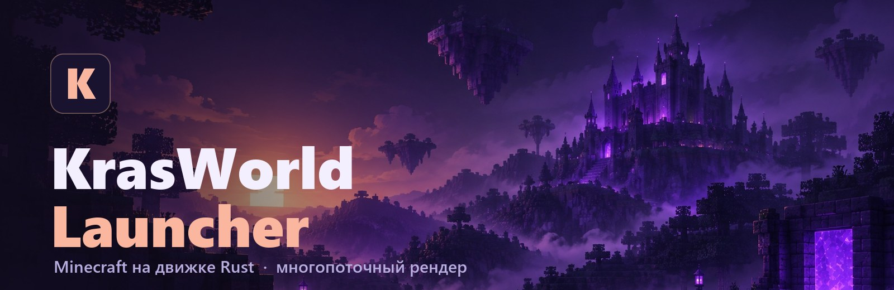
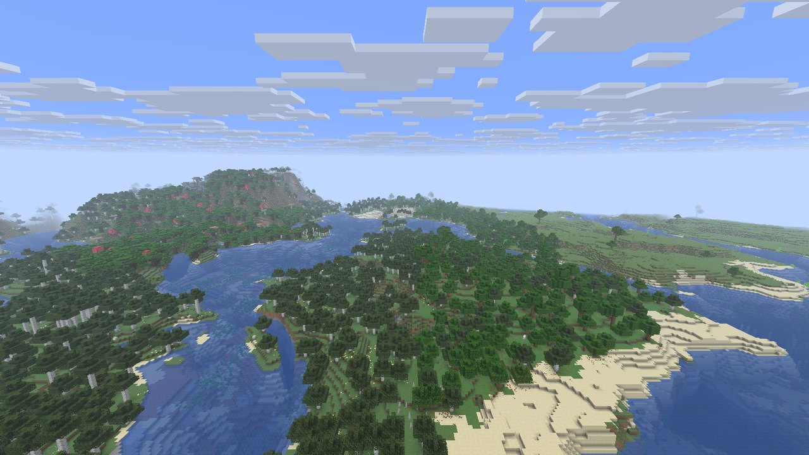
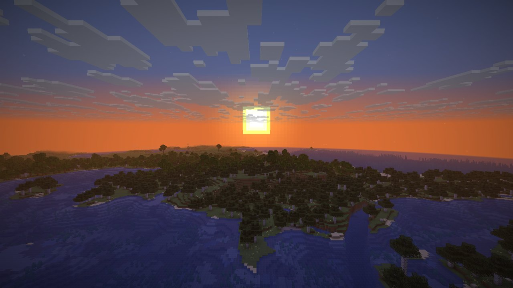
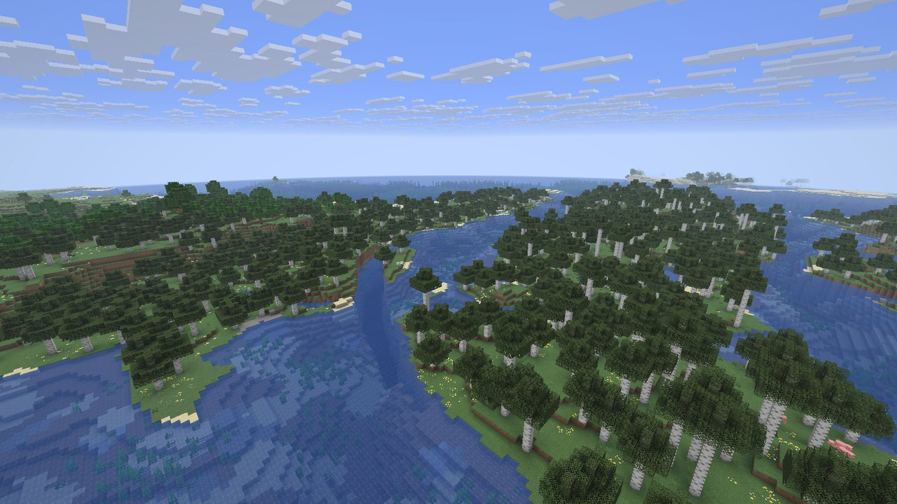
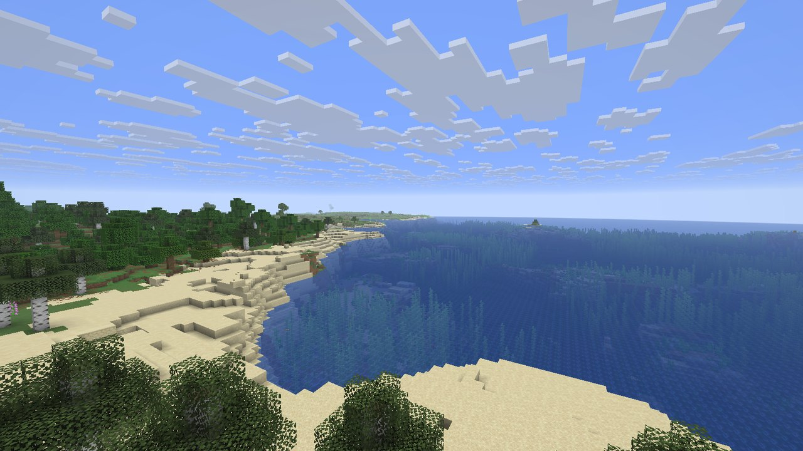
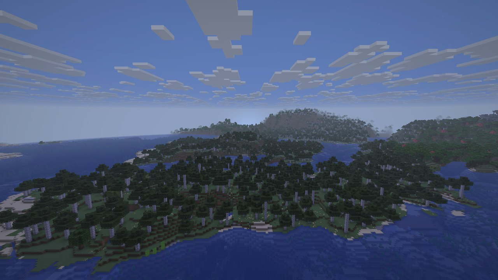
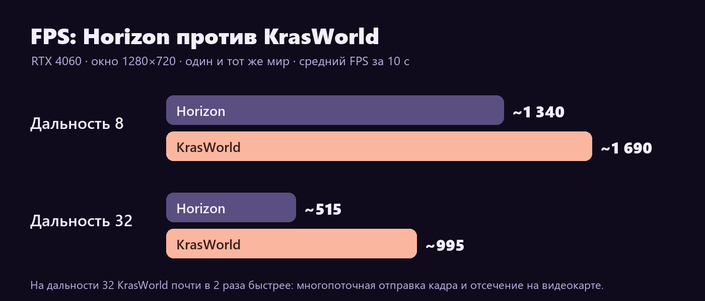
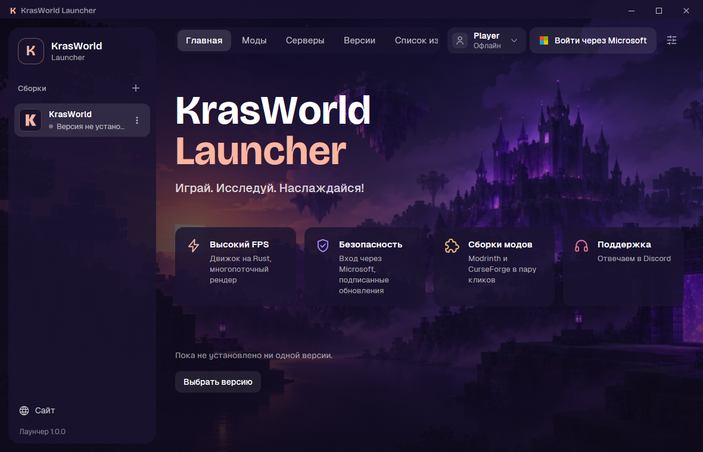
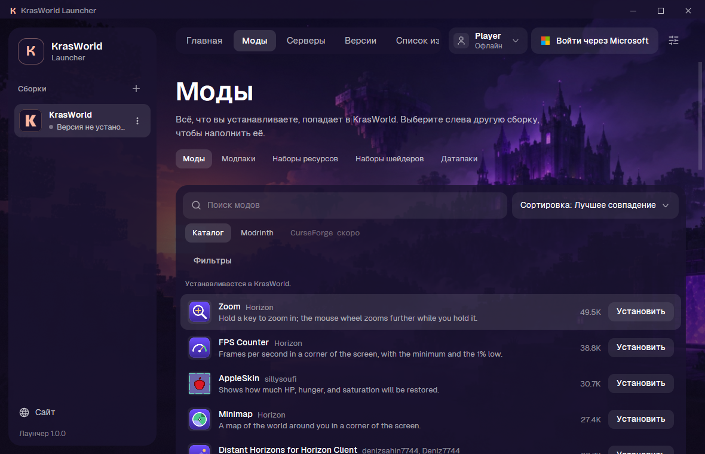

  

  
  
  
  

  <b>Лаунчер KrasWorld для Minecraft: Java Edition.</b> 
  Свой движок на Rust, многопоточный рендер и почти вдвое больше FPS на большой дальности прорисовки.

  <a href="https://github.com/ZloyPivasik/krasworld-launcher/releases/latest/download/krasworld-launcher-setup.exe"><b>⬇ Скачать для Windows</b></a>

  

## ✨ Чем KrasWorld особенный

- **Движок на Rust вместо Java.** Мир, рендер и игровая логика переписаны на Rust: без виртуальной машины Java и её сборщика мусора.
- **Многопоточный рендер.** Подготовка и отправка кадра идут в отдельном потоке, а невидимые куски мира отсекает видеокарта, а не процессор. В KrasWorld это включено сразу.
- **Большая дальность без мучений.** Чем дальше прорисовка, тем сильнее отрыв: на 32 чанках FPS почти вдвое выше.
- **Моды в пару кликов.** Каталог модов и Modrinth прямо в лаунчере, импорт сборок `.mrpack` и CurseForge.
- **Несколько сборок.** У каждой свои моды, миры и настройки.
- **Свой сервер.** Лаунчер поднимет сервер для игры с друзьями прямо с твоего компьютера.
- **Безопасность.** Вход только через аккаунт Microsoft; каждое обновление подписано ключом KrasWorld, и лаунчер не поставит файл с чужой подписью.

## 🎮 В игре

<table>
  <tr>
    <td width="50%"></td>
    <td width="50%"></td>
  </tr>
  <tr>
    <td width="50%"></td>
    <td width="50%"></td>
  </tr>
</table>

Все кадры сняты в KrasWorld на дальности прорисовки 32 чанка.

## ⚡ Производительность

  

| Дальность прорисовки | Horizon | **KrasWorld** | Разница |
|---|---|---|---|
| 8 чанков | ~1 340 FPS | **~1 690 FPS** | +26% |
| 32 чанка | ~515 FPS | **~995 FPS** | **×1,9** |

1% худших кадров на 32 чанках: ~290 FPS у Horizon против ~450–550 у KrasWorld.
Замер: NVIDIA RTX 4060, окно 1280×720, один и тот же мир и место, средний FPS за 10 секунд. На другом железе цифры будут другими.

## 🖥 Лаунчер

<table>
  <tr>
    <td width="50%"></td>
    <td width="50%"></td>
  </tr>
</table>

## 📥 Установка

| Что | Файл | Нужно |
|---|---|---|
| Windows x64 | [`krasworld-launcher-setup.exe`](https://github.com/ZloyPivasik/krasworld-launcher/releases/latest/download/krasworld-launcher-setup.exe) | Windows 10 или 11, видеокарта с Vulkan или DirectX 12 |

1. Скачай установщик и запусти: лаунчер установится и создаст ярлык.
2. Войди через аккаунт Microsoft, на котором куплена Minecraft: Java Edition.
3. Жми **Играть**. Дальше лаунчер обновляется сам.

---

Не является официальным продуктом Minecraft. Не одобрено Mojang или Microsoft и не связано с ними.
Лицензии использованных компонентов: <a href="LICENSE">LICENSE</a>, <a href="THIRD_PARTY_NOTICES.md">THIRD_PARTY_NOTICES.md</a>, <a href="NOTICE.txt">NOTICE.txt</a>.
