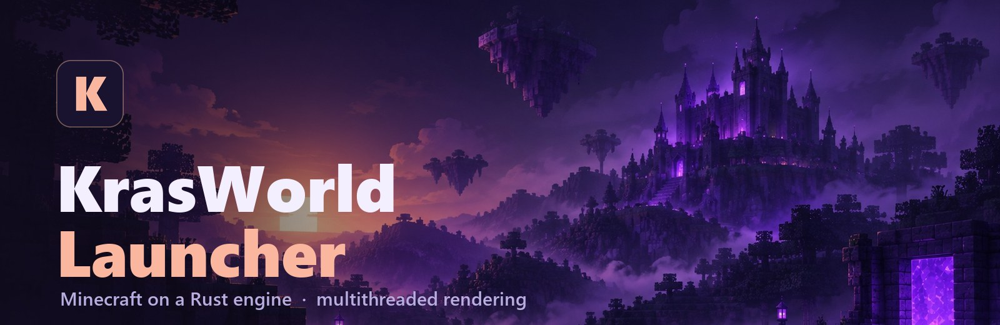
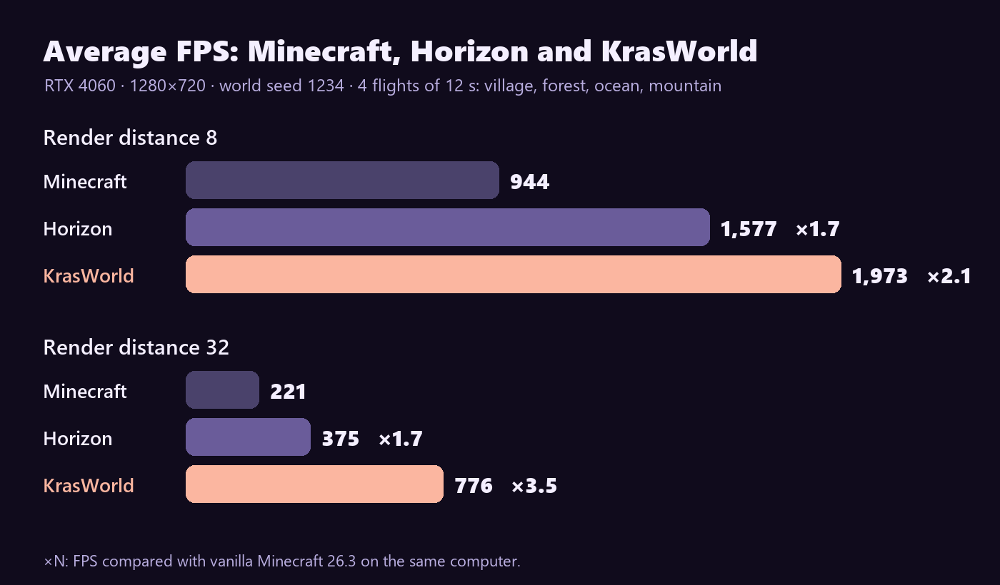

  

  
  
  
  

  <b>English</b> · <a href="#русский">Русский</a>

  <b>The KrasWorld launcher for Minecraft: Java Edition.</b> 
  Its own Rust engine, multithreaded rendering and 2–3.5× the FPS of vanilla Minecraft.

  <a href="https://github.com/ZloyPivasik/krasworld-launcher/releases/latest/download/krasworld-launcher-setup.exe"><b>⬇ Download for Windows</b></a>

  

## ✨ What makes KrasWorld different

- **A Rust engine instead of Java.** The world, the renderer and the game logic are rewritten in Rust: no Java virtual machine and no garbage collector.
- **Multithreaded rendering.** Frames are prepared and submitted on a thread of their own, and the GPU, not the CPU, culls the parts of the world you can't see. In KrasWorld this is on from the start.
- **Far render distances without the pain.** The further you look, the bigger the lead: at 32 chunks the FPS is 3.5× that of vanilla Minecraft.
- **Less memory, faster loading.** Half the RAM of vanilla Minecraft, and worlds open almost 4× faster.
- **Mods in a couple of clicks.** A mod catalog and Modrinth right in the launcher; import `.mrpack` and CurseForge modpacks.
- **Several instances.** Each with its own mods, worlds and settings.
- **Your own server.** The launcher runs a server for your friends right on your computer.
- **Security.** Sign-in with a Microsoft account only; every update is signed with KrasWorld's key, and the launcher installs nothing whose signature doesn't match.

## 🎮 In game

<table>
  <tr>
    <td width="50%"></td>
    <td width="50%"></td>
  </tr>
  <tr>
    <td width="50%"></td>
    <td width="50%"></td>
  </tr>
</table>

Every shot was taken in KrasWorld at a render distance of 32 chunks.

## ⚡ Performance

  

| | Minecraft 26.3 | Horizon | **KrasWorld** |
|---|---|---|---|
| Average FPS, distance 8 | 944 | 1,577 | **1,973** (×2.1) |
| Average FPS, distance 32 | 221 | 375 | **776** (×3.5) |
| 1% low FPS, distance 8 | 219 | **535** | 479 |
| 1% low FPS, distance 32 | 47 | 111 | **174** |
| Memory (RAM), distance 32 | 2,766 MB | 1,664 MB | **1,210 MB** |
| World start, distance 8 | 27.9 s | 9.3 s | **6.8 s** |

How it was measured: one computer (NVIDIA RTX 4060), a 1280×720 window, VSync off, uncapped FPS. A new world with seed 1234 and four 12-second flights over a village, a forest, the ocean and mountains; the table gives the mean of the four scenes, one run per game. Vanilla Minecraft 26.3 ran from its own files with the official launcher's settings (plus the Fabric loader for the mod that counts frames). Other hardware will give other numbers.

## 🖥 The launcher

<table>
  <tr>
    <td width="50%"></td>
    <td width="50%"></td>
  </tr>
</table>

## 📥 Install

| Platform | File | Needs |
|---|---|---|
| Windows x64 | [`krasworld-launcher-setup.exe`](https://github.com/ZloyPivasik/krasworld-launcher/releases/latest/download/krasworld-launcher-setup.exe) | Windows 10 or 11, a GPU with Vulkan or DirectX 12 |

1. Download the installer and run it: the launcher installs itself and makes a shortcut.
2. Sign in with the Microsoft account that owns Minecraft: Java Edition.
3. Press **Play**. From then on the launcher updates itself.

 

---

  <a href="#">English</a> · <b>Русский</b>

# Русский

  <b>Лаунчер KrasWorld для Minecraft: Java Edition.</b> 
  Свой движок на Rust, многопоточный рендер и в 2–3,5 раза больше FPS, чем у обычного Minecraft.

  <a href="https://github.com/ZloyPivasik/krasworld-launcher/releases/latest/download/krasworld-launcher-setup.exe"><b>⬇ Скачать для Windows</b></a>

## ✨ Чем KrasWorld особенный

- **Движок на Rust вместо Java.** Мир, рендер и игровая логика переписаны на Rust: без виртуальной машины Java и её сборщика мусора.
- **Многопоточный рендер.** Подготовка и отправка кадра идут в отдельном потоке, а невидимые куски мира отсекает видеокарта, а не процессор. В KrasWorld это включено сразу.
- **Большая дальность без мучений.** Чем дальше прорисовка, тем сильнее отрыв: на 32 чанках FPS в 3,5 раза выше, чем у обычного Minecraft.
- **Меньше памяти и быстрая загрузка.** Вдвое меньше оперативной памяти, чем у обычного Minecraft, и мир открывается почти в 4 раза быстрее.
- **Моды в пару кликов.** Каталог модов и Modrinth прямо в лаунчере, импорт сборок `.mrpack` и CurseForge.
- **Несколько сборок.** У каждой свои моды, миры и настройки.
- **Свой сервер.** Лаунчер поднимет сервер для игры с друзьями прямо с твоего компьютера.
- **Безопасность.** Вход только через аккаунт Microsoft; каждое обновление подписано ключом KrasWorld, и лаунчер не поставит файл с чужой подписью.

## ⚡ Производительность

  

| | Minecraft 26.3 | Horizon | **KrasWorld** |
|---|---|---|---|
| Средний FPS, дальность 8 | 944 | 1 577 | **1 973** (×2,1) |
| Средний FPS, дальность 32 | 221 | 375 | **776** (×3,5) |
| 1% худших кадров, дальность 8 | 219 | **535** | 479 |
| 1% худших кадров, дальность 32 | 47 | 111 | **174** |
| Память (RAM), дальность 32 | 2 766 МБ | 1 664 МБ | **1 210 МБ** |
| Запуск мира, дальность 8 | 27,9 с | 9,3 с | **6,8 с** |

Как мерили: один и тот же компьютер (NVIDIA RTX 4060), окно 1280×720, VSync выключен, FPS без ограничения. Новый мир с seed 1234 и четыре полёта по 12 секунд над деревней, лесом, океаном и горами; в таблице среднее по четырём сценам, по одному прогону на игру. Обычный Minecraft 26.3 запущен из своих файлов с настройками официального лаунчера (плюс загрузчик Fabric для мода, который считает кадры). На другом железе цифры будут другими.

Скриншоты игры и лаунчера — в английском разделе выше.

## 📥 Установка

| Что | Файл | Нужно |
|---|---|---|
| Windows x64 | [`krasworld-launcher-setup.exe`](https://github.com/ZloyPivasik/krasworld-launcher/releases/latest/download/krasworld-launcher-setup.exe) | Windows 10 или 11, видеокарта с Vulkan или DirectX 12 |

1. Скачай установщик и запусти: лаунчер установится и создаст ярлык.
2. Войди через аккаунт Microsoft, на котором куплена Minecraft: Java Edition.
3. Жми **Играть**. Дальше лаунчер обновляется сам.

---

Not an official Minecraft product. Not approved by or associated with Mojang or Microsoft. · Не является официальным продуктом Minecraft. Не одобрено Mojang или Microsoft и не связано с ними. 
Licenses of the components used · Лицензии использованных компонентов: <a href="LICENSE">LICENSE</a>, <a href="THIRD_PARTY_NOTICES.md">THIRD_PARTY_NOTICES.md</a>, <a href="NOTICE.txt">NOTICE.txt</a>.
